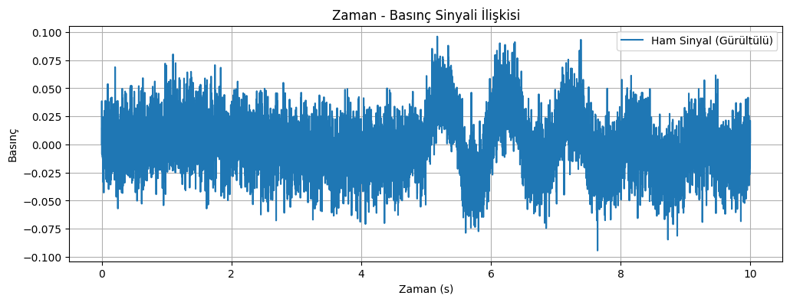
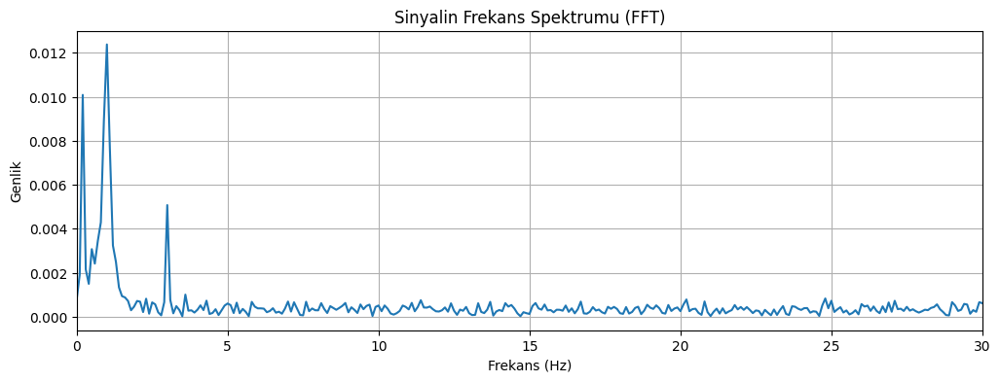
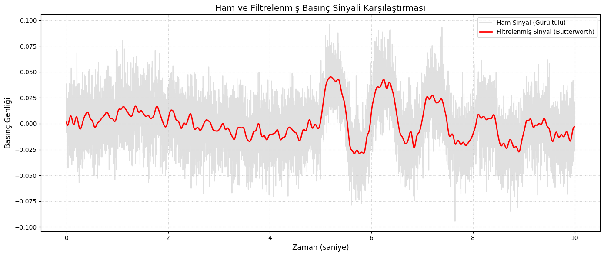

# Underwater Vehicle Pressure Signal Processing

Noise filtering and spectral analysis of a pressure-sensor signal from an underwater vehicle, used to detect vertical maneuvers (diving / rising).

> Dataset: `havuz_sinyal_simulasyonu.csv` — a simulated pool-test pressure signal (10 s, 1 kHz, 10,000 samples).

## Pipeline

| Step | Method | Notes |
|---|---|---|
| 1. Data inspection | Pandas | 10 s record, sampled at **fs = 1000 Hz** |
| 2. Frequency analysis | FFT (`scipy.fft`) | Single-sided amplitude spectrum; dominant content at **~1 Hz**, well below the noise band |
| 3. Noise filtering | 4th-order **Butterworth low-pass**, f<sub>c</sub> = 10 Hz | Applied with `filtfilt` (zero-phase) so maneuver timing is not shifted |
| 4. Interpretation | Visual comparison | Filtered signal reveals the dive/rise events (≈5–7.5 s) hidden in the raw data |

## Results

The filter removes the high-frequency noise, which makes up roughly **60% of the raw signal's variance**, while keeping the low-frequency maneuver content intact.

**Raw signal**


**FFT spectrum (0–30 Hz)**


**Raw vs. filtered**


## Design choices

- **Butterworth:** maximally flat passband, so the maneuver amplitude is not distorted.
- **f<sub>c</sub> = 10 Hz:** about an order of magnitude above the dominant ~1 Hz component, leaving margin for faster maneuvers while rejecting broadband noise.
- **Zero-phase filtering (`filtfilt`):** forward-backward filtering cancels phase delay, which matters when the goal is to time events.

## Files

- `havuz_sinyal.ipynb` — full analysis notebook (Turkish comments)
- `havuz_sinyal_rapor.pdf` — project report
- `havuz_sinyal_simulasyonu.csv` — signal data
- `figures/` — exported plots

## Run

```bash
pip install pandas numpy scipy matplotlib jupyter
jupyter notebook havuz_sinyal.ipynb
```

**Tools:** Python · NumPy · Pandas · SciPy · Matplotlib
